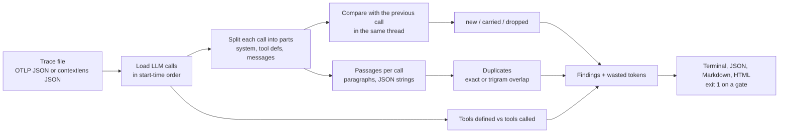

# contextlens

See what each LLM call in an agent trace actually carried in its context window: what was added, carried over, repeated or dropped, and how many tokens were wasted.


▶ [Watch the 50-second demo video](https://github.com/sumankrsh/contextlens/releases/latest/download/demo.mp4)

## The problem

An agent doesn't send one prompt. It sends a growing pile of text with every call: the system prompt, every tool definition, the conversation so far, and every tool result it has collected. Frameworks add, re-send and trim that pile for you, so nobody on the team sees what the model was actually given at step 6. Two things go wrong quietly:

- **Waste.** Tool definitions the agent never uses are re-sent with every call. A search tool brings back clauses the agent already has, and the copies ride along with every later call. You pay for all of it, and the model has more noise to read.
- **Loss.** When the history gets long, frameworks drop the oldest messages. Sometimes the dropped message is the one where the user said "email only, please don't call me", and the agent later offers to call.

Tracing platforms record these calls, but they show each span on its own. `contextlens` lines the calls up and compares each one with the call before it, so you can see the context window change over a run, and it turns the waste and the losses into findings you can gate in CI.

## Quickstart

```bash
git clone https://github.com/sumankrsh/contextlens && cd contextlens
pip install .
contextlens analyze examples/claims-agent.otel.json --html report.html
```

The bundled trace is a synthetic claims assistant exported as OpenTelemetry GenAI spans: six LLM calls, seven tool definitions, three of them used. It finishes in about a quarter of a second and needs no API key. The terminal shows each call's size, what was new, carried and dropped, and the findings:

| Finding | Tokens wasted |
|---|---:|
| 4 tools defined in all 6 calls and never called | 2,778 |
| 3 policy clauses retrieved again by a second and third search | 829 |
| **Total** | **3,607 of 11,393 (31.7%)** |

Open `report.html` for the viewer: a stacked bar per call with the wasted part hatched, the findings, and every call broken down part by part.

Then run the second example as a CI gate:

```bash
contextlens analyze examples/support-chat.json --fail-on high
```

This support chat's framework drops the oldest messages once the history passes 12 messages. In step 8 the customer's first message, which says they can only be reached by email, is gone. `contextlens` reports a high-severity `lost-instruction` and exits 1. To see exactly what step 8 was sent and what it lost:

```bash
contextlens show examples/support-chat.json 8
```

## Features

- **Reads the traces you already have.** OpenTelemetry OTLP JSON exports (one document, or one per line as the collector's file exporter writes them) using either the GenAI semantic conventions (`gen_ai.input.messages`, `gen_ai.system_instructions`, `gen_ai.tool.definitions`, `gen_ai.output.messages`) or the older indexed attributes (`gen_ai.prompt.0.content`, `llm.request.functions.0.name`, ...). Also a plain JSON format with OpenAI-style chat messages.
- **Call-by-call diff.** Every message and tool definition in a call is marked new or carried over from the previous call in the same thread, and anything the previous call had that this one doesn't is listed as dropped. Calls that share no conversation with earlier ones (a sub-agent, a summariser) start their own thread, so they don't show up as losses.
- **Seven rules.** Run `contextlens rules` to list them.

  | Rule | Severity | Counts as waste | Checks for |
  |---|---|---|---|
  | `duplicate-content` | medium | yes | The same passage, exact or near-identical, appears more than once in one call's context. |
  | `unused-tool` | medium | yes | A tool definition is sent with calls but the tool is never called anywhere in the trace. |
  | `lost-instruction` | high | no | A system or user message in one call is missing from the next call in the same thread. |
  | `history-trimmed` | low | no | Assistant turns or tool results in one call are missing from the next call in the same thread. |
  | `over-limit` | high | no | A call's context is larger than the model's context limit. |
  | `near-limit` | medium | no | A call's context uses at least the warning share (default 90%) of the model's context limit. |
  | `large-tool-result` | low | no | One tool result takes up a large share (40%, and at least 500 tokens) of a call's context and is re-sent with every later call. |

- **CI gates.** `--max-waste 15` exits 1 when wasted tokens are more than 15% of all input tokens; `--fail-on high` (or `medium`, `low`) exits 1 when there is a finding at that severity or worse. A [GitHub Actions example](examples/github-workflow.yml) is included.
- **Reports.** Terminal tables (with a compact layout under 90 columns), `--json` with every call and segment, `--markdown` for a job summary, and `--html`: one self-contained page with no scripts and no external requests, in light and dark themes.
- **Record your own agent.** `contextlens.recorder.Recorder` writes the plain JSON format from your code with one `record(...)` call after each LLM request. See [examples/record_your_agent.py](examples/record_your_agent.py) (`python examples/record_your_agent.py`).
- **Offline.** No API key, no network, no model calls. Your traces stay on your machine.

## How it works



1. Each LLM span (or call) becomes a list of parts: one per tool definition and one per message. Parts are identified by a hash of their role, tool name and whitespace-normalised text.
2. A call's parent is the latest earlier call that shares at least one user, assistant or tool message with it. Parts also in the parent are "carried"; parts of the parent missing here are "dropped".
3. For duplicates, each message is split into passages: paragraphs, or the string values inside a JSON tool result. Passages shorter than 20 tokens are ignored. Two passages are the same when their normalised text matches or their word-trigram sets overlap by at least 80% (Jaccard). In each call, every copy after the first counts as wasted, so a duplicate carried through four calls is counted four times, because it was paid for four times.
4. A tool is unused when it is defined but never appears as a tool call or tool result anywhere in the trace. Its definition's tokens count as wasted in every call that carried it.
5. Waste share is wasted tokens divided by the sum of every call's context size.

### Token counts

Token counts are estimated offline with a small rule-based estimator: words of up to eight letters are one token, longer words about one token per six letters, digits one per three, punctuation one per two characters, plus 4 tokens per message for role markers. `scripts/measure_tokens.py` compares it with two public tokenizers (`cl100k_base` and `o200k_base`, via `tiktoken`) on the 47 distinct texts in the bundled traces: the estimate's total was 2.2% higher than both, with a median per-text error of about 9% and a worst case of 33% (a short tool call with JSON arguments). Different models tokenize differently, so treat single-call figures as approximate.

When a call reports the provider's own count (`gen_ai.usage.input_tokens`, or `usage.input_tokens` / `prompt_tokens` in the JSON format), the estimates for that call are scaled so they add up to it. The report says how many calls were scaled this way.

## Configuration

### The contextlens JSON format

```json
{
  "name": "my-agent run 42",
  "context_limit": 128000,
  "calls": [
    {
      "model": "my-model",
      "tools": [{"type": "function", "function": {"name": "get_order", "description": "...", "parameters": {}}}],
      "messages": [
        {"role": "system", "content": "..."},
        {"role": "user", "content": "Where is my order?"}
      ],
      "output": {"role": "assistant", "tool_calls": [{"id": "c1", "type": "function", "function": {"name": "get_order", "arguments": "{}"}}]},
      "usage": {"input_tokens": 812, "output_tokens": 20}
    }
  ]
}
```

Each call lists the full context it was sent, as your code passed it to the chat API. `messages` is required; `tools`, `output`, `model`, `usage` and `context_limit` (per call, or once at the top) are optional. Message `content` may be a string or a list of content parts. Tool results without a `name` are named from the matching `tool_call_id`.

### Options for `analyze`

| Option | Default | Meaning |
|---|---|---|
| `--html`, `--json`, `--markdown` | off | Write a report to this path. |
| `--context-limit` | from the trace | Context limit in tokens for every call. OpenTelemetry has no standard attribute for it, so pass it here for OTLP traces. |
| `--limit-warn` | 90 | Percent of the context limit at which `near-limit` fires. |
| `--min-passage-tokens` | 20 | Shorter passages are not compared for duplicates. |
| `--similarity` | 0.8 | Word-trigram overlap at which two passages count as the same. 1.0 means exact matches only. |
| `--max-waste` | off | Exit 1 when wasted tokens exceed this percent of input tokens. |
| `--fail-on` | off | Exit 1 on a finding at this severity or worse: `high`, `medium` or `low`. |
| `--trace-id` | | Which trace to read when the file holds several. |

`contextlens show TRACE STEP [--full]` lists one call's parts with their status, tokens and content, and what was dropped. Exit status: 0 on success, 1 when a gate fails, 2 for a bad file or option.

## Limitations

- The figures in this README come from running the commands above on the bundled synthetic traces, on a Linux cloud machine with Python 3.11. They show how the tool works; they don't say how much any real agent wastes.
- Token counts are estimates unless the trace reports input tokens (see "Token counts" above). The estimator was calibrated on English text and JSON; code and other languages will be less accurate.
- "Wasted" is a mechanical judgement: an unused tool may be there on purpose for rare cases, and a repeated passage may be repeated deliberately. The findings tell you where to look, not what to delete.
- A dropped message is detected by comparing a call with its parent. If a framework rewrites messages (for example, replacing old turns with a summary), the originals show as dropped and the summary as new; contextlens doesn't judge whether the summary kept the instruction.
- Only text is counted. Images, audio and files in messages are not measured, and provider-side cached tokens are not distinguished from uncached ones.
- OpenTelemetry instrumentation libraries differ, and many only record message content when content capture is switched on. Traces without message content can't be analysed. Span events and log records that carry messages separately from spans are not read in this version.
- All sample data is synthetic: the insurer, customers, claims and policy wording are made up.

## More tools

Part of a small family of open-source tools for running AI with governance built in:

- **[ai-register](https://github.com/sumankrsh/ai-register)**: scans a codebase and keeps an AI inventory for EU AI Act and ISO/IEC 42001 reviews.
- **[mcp-gatekeeper](https://github.com/sumankrsh/mcp-gatekeeper)**: permissions, approvals and a tamper-evident audit log for MCP tool calls.
- **[enterprise-data-skills](https://github.com/sumankrsh/enterprise-data-skills)**: everyday data checks (SQL review, profiling, PII scans, model cards) for people and agents.
- **[agentbreak](https://github.com/sumankrsh/agentbreak)**: tests whether an attack makes an AI agent take an unauthorised action.
- **[prompt-ci](https://github.com/sumankrsh/prompt-ci)**: keeps prompts as owned, versioned and tested code, with a CI gate on changes.
- **[ai-policy-lint](https://github.com/sumankrsh/ai-policy-lint)**: checks agent configs, MCP configs and prompts against your company's AI policy.
- **[agent-crashlab](https://github.com/sumankrsh/agent-crashlab)**: injects tool failures into an agent and counts what it does twice.
- **[model-cost-pilot](https://github.com/sumankrsh/model-cost-pilot)**: routes each kind of request to the cheapest model that still passes your checks.
- **contextlens**: this tool, showing what each call's context window held and where tokens were wasted.

See [github.com/sumankrsh](https://github.com/sumankrsh) for newer tools.

## Credits

No code was adapted from other projects. The OpenTelemetry [GenAI semantic conventions](https://opentelemetry.io/docs/specs/semconv/gen-ai/) define the span attributes read here. Full tracing platforms such as [Langfuse](https://github.com/langfuse/langfuse), [Arize Phoenix](https://github.com/Arize-ai/phoenix) and [Opik](https://github.com/comet-ml/opik) collect and display these traces at scale; use them for observability. contextlens is narrower: an offline file-in, report-out check of how the context changes between calls, with CI gates.

## Licence

MIT. See [LICENSE](LICENSE).
